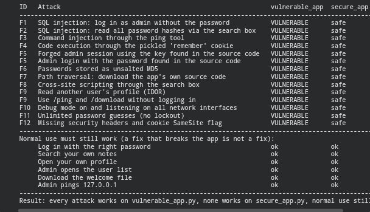
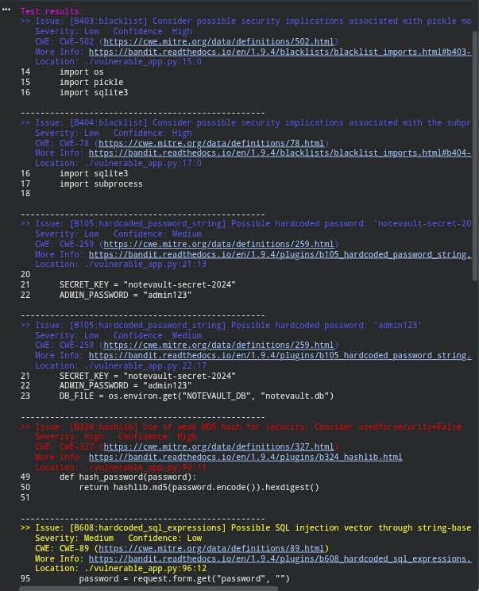
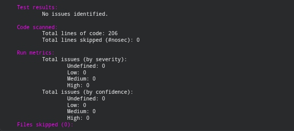

# NoteVault Secure Coding Review (Python / Flask)

**CodeAlpha Cyber Security Internship, Task 3.**

## 📌 Project Overview
A secure code review of a small Flask web app. The vulnerabilities are found with static analysis (Bandit) and manual review, proved with real attacks, fixed, and written up in a report.

> **Warning.** `vulnerable_app.py` is insecure on purpose. Run it only on your own computer, for a short time, and never put it on a network or the internet. It listens on all network interfaces (finding F10), so stop it with Ctrl+C when you are done.

## 🎯Objectives

- elect a programming language and application to audit.

- Perform a code review to identify security vulnerabilities.

- Use tools like static analyzers or manual inspection methods.

- Provide recommendations and best practices for secure coding.

- Document findings and suggest remediation steps for safer code.

NoteVault was written for this exercise, with common real-world mistakes added on purpose.

## What is in this repository

| File | Purpose |
|---|---|
| `REVIEW_REPORT.md` | The review: 12 findings with severity, proof, impact, fix and secure coding recommendations |
| `vulnerable_app.py` | The application under review (intentionally insecure) |
| `secure_app.py` | The fixed version |
| `test_security.py` | Replays the attacks against both versions and checks that normal use still works |
| `requirements.txt` | Python packages: Flask and Bandit |
| `screenshot_*.jpg` | Screenshots of the test run and the two Bandit scans (see Results) |

## Findings

| ID | Finding | Severity |
|---|---|---|
| F1 | SQL injection in login | Critical |
| F2 | SQL injection in note search | High |
| F3 | OS command injection in the ping tool | Critical |
| F4 | Insecure deserialization (pickle cookie) | Critical |
| F5 | Hard-coded secret key and admin password | High |
| F6 | Passwords hashed with unsalted MD5 | Medium |
| F7 | Path traversal in file download | High |
| F8 | Reflected cross-site scripting (XSS) in search | Medium |
| F9 | Broken access control: IDOR and missing login checks | High |
| F10 | Debug mode on, listening on all interfaces | High |
| F11 | No protection against password guessing | Medium |
| F12 | Missing security headers and cookie flags | Low |

Details, proof and fixes are in [REVIEW_REPORT.md](REVIEW_REPORT.md).

## How the review was done

1. **Static analysis** with Bandit: `bandit vulnerable_app.py`. It has checks for 7 of the 12 findings.
2. **Manual review** against the OWASP Top 10 (2021). This found the other 5 (path traversal, XSS, broken access control, no brute-force protection, missing headers).
3. **Dynamic testing**: `test_security.py` sends the attack payloads to both versions of the app.
4. **Fixing**: every finding is fixed in `secure_app.py`, and the same tests prove the attacks no longer work.

## Run it

```text
pip install -r requirements.txt
python test_security.py
bandit vulnerable_app.py
bandit secure_app.py
```

To keep the Bandit output as a file: `bandit vulnerable_app.py -f txt -o bandit_vulnerable.txt`.

To try the apps in a browser, run `python vulnerable_app.py` (or `python secure_app.py`) and open <http://127.0.0.1:5000>. Demo accounts: `alice` with password `alice-pass-1`, and `bob` with password `bob-pass-2`. The secure app prints a random admin password when it starts. Things to try on the vulnerable app:

| Where | What to type |
|---|---|
| Login form, username | `admin' --` (any password) |
| Search box (log in as alice first) | `zzz' UNION SELECT username, password FROM users --` |
| Search box | `<script>alert(1)</script>` |
| Ping box | `127.0.0.1 & whoami` on Windows, `127.0.0.1; id` on Linux or macOS |
| Address bar | `/download?file=../vulnerable_app.py` |
| Address bar (logged in as alice) | `/profile/1` |

## Results

These screenshots were taken in Google Colab, running the same files that are in this repository.

### Attack tests: `python test_security.py`

`VULNERABLE` means the attack worked, `safe` means the app stopped it.



<details>
<summary>The same output as text</summary>

```text
ID   Attack                                                        vulnerable_app  secure_app
-----------------------------------------------------------------------------------------------
F1   SQL injection: log in as admin without the password           VULNERABLE      safe
F2   SQL injection: read all password hashes via the search box    VULNERABLE      safe
F3   Command injection through the ping tool                       VULNERABLE      safe
F4   Code execution through the pickled 'remember' cookie          VULNERABLE      safe
F5   Forged admin session using the key found in the source code   VULNERABLE      safe
F5   Admin login with the password found in the source code        VULNERABLE      safe
F6   Passwords stored as unsalted MD5                              VULNERABLE      safe
F7   Path traversal: download the app's own source code            VULNERABLE      safe
F8   Cross-site scripting through the search box                   VULNERABLE      safe
F9   Read another user's profile (IDOR)                            VULNERABLE      safe
F9   Use /ping and /download without logging in                    VULNERABLE      safe
F10  Debug mode on and listening on all network interfaces         VULNERABLE      safe
F11  Unlimited password guesses (no lockout)                       VULNERABLE      safe
F12  Missing security headers and cookie SameSite flag             VULNERABLE      safe
-----------------------------------------------------------------------------------------------
Normal use must still work (a fix that breaks the app is not a fix):
     Log in with the right password                                ok              ok
     Search your own notes                                         ok              ok
     Open your own profile                                         ok              ok
     Admin opens the user list                                     ok              ok
     Download the welcome file                                     ok              ok
     Admin pings 127.0.0.1                                         ok              ok
-----------------------------------------------------------------------------------------------
Result: every attack works on vulnerable_app.py, none works on secure_app.py, normal use still works.
```

</details>

### Bandit scan of `vulnerable_app.py`



Bandit reports several issues. The screenshot shows the top of the report: the pickle and subprocess imports (B403, B404), the two hard-coded secrets (B105), the weak MD5 hash (B324) and string-built SQL (B608). Run `bandit vulnerable_app.py` to see the whole report.

### Bandit scan of `secure_app.py`



Bandit finds no issues in the fixed version. Two lines are marked `# nosec` on purpose, and section 5 of the report explains why.

## Takeaways

- Never build SQL, shell commands or HTML by joining strings with user input. Use query parameters, argument lists and auto-escaping templates.
- Check permissions on the server for every request. Do not trust data that comes from the client.
- Keep secrets out of the code and hash passwords with a slow, salted algorithm.
- A scanner like Bandit is a good start, but 5 of the 12 problems were only found by reading the code and testing it.

# 👤 Author

**ADEBAYO IBRAHIM**\
Cybersecurity Professional

LinkedIn: [www.linkedin.com/in/ibrahim-adebayo-118613449](www.linkedin.com/in/ibrahim-adebayo-118613449/)

---

## 📌 Project Information

**Program Name:** Cybersecurity at CodeAlpha | **Task 03** Secure Code Review | **Repository:** GitHub
